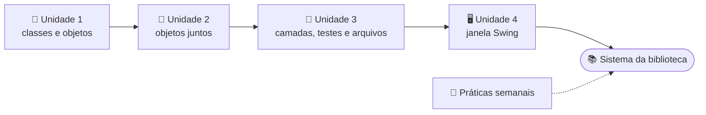

<div align="center">

# ☕ POO I — Programação Orientada a Objetos I

**IFMT Campus Várzea Grande · Técnico em Informática para Internet Integrado ao Médio · 3º semestre · 2026/2**


Apostila, exemplos que rodam, práticas semanais e um sistema completo de biblioteca em Swing.<br>
Tudo em Java puro: não precisa instalar biblioteca nem estar conectado à internet.

📘 [**Apostila do Aluno (PDF)**](apostila/Apostila_POO_I_Java_Aluno.pdf) · 🧪 [**Práticas semanais**](atividades) · 📚 [**Sistema da biblioteca**](sistema_biblioteca)

</div>

---

## 🚀 Comece por aqui

1. **Baixe o repositório.** No GitHub: botão verde **Code > Download ZIP** e extraia. Quem usa Git: `git clone https://github.com/Schavess/ifmt-vg-poo1.git`.
2. **Abra a apostila** em [`apostila/Apostila_POO_I_Java_Aluno.pdf`](apostila/Apostila_POO_I_Java_Aluno.pdf). Ela diz, capítulo a capítulo, qual exemplo rodar.
3. **Abra o projeto no NetBeans:** **File > Open Project** e escolha a pasta com o ícone de xícara ☕ (veja a tabela [abaixo](#-como-abrir-no-netbeans)).
4. **Rode o exemplo:** botão direito no arquivo > **Run File** (`Shift+F6`).

---

## 🗂️ O que tem aqui

| Pasta | O que é | Para quê |
|---|---|---|
| 📘 [`apostila`](apostila) | A apostila (PDF e Word) e os exemplos dos capítulos 1 a 16, um pacote por capítulo | Estudar a matéria com código que roda |
| 🧪 [`atividades`](atividades) | Uma pasta por prática semanal de laboratório | Praticar em aula, a partir de um molde com `TODO` |
| 📚 [`sistema_biblioteca`](sistema_biblioteca) | Sistema de empréstimos com janela, regras, testes e arquivo CSV | Capítulos 17 e 18: juntar tudo num sistema de verdade |
| 🔎 [`base_conhecimento`](base_conhecimento) | Exemplos curtos, do Java básico à prévia de herança | Consulta rápida |

---

## 📘 A apostila

A apostila é uma **escada**: cada capítulo usa o anterior, e todos convergem para o mesmo lugar, um **sistema de empréstimos da biblioteca** com janela, regras e dados gravados em arquivo.

| Unidade | Capítulos | Assunto |
|---|---|---|
| **1 · Revisão** | 1 a 5 | Por que OO, Java essencial, classes e objetos, encapsulamento, UML |
| **2 · Objetos que trabalham juntos** | 6 a 11 | Construtores, `static`, `toString`, `equals`, `ArrayList`, associação, composição, exceções, herança |
| **3 · Do enunciado ao programa** | 12 a 14 | Projetar em camadas, testar, gravar e ler arquivos |
| **4 · Uma aplicação de verdade** | 15 a 18 | Janelas com Swing e o sistema da biblioteca |



Cada capítulo traz **De onde viemos → A ideia → No código → Armadilhas → Na biblioteca → Exercícios** (fixação, aplicação e desafio, com a saída esperada para você conferir sozinho).

---

## 🧪 Práticas semanais

Toda semana pode entrar uma prática nova em [`atividades`](atividades), **no mesmo formato** das que já estão lá. O nome da pasta traz a data e o tema, e cada uma é um projeto NetBeans completo.

| Data | Pasta | Prática | Capítulos |
|---|---|---|---|
| 27/10 | [`2026-10-27_Aula01_Biblioteca`](atividades/2026-10-27_Aula01_Biblioteca) | Da UML ao Java: `ItemBiblioteca` e `Livro` | 4, 5, 11 |
| 03/11 | [`2026-11-03_Aula02_Leitores`](atividades/2026-11-03_Aula02_Leitores) | Leitores, acervo e `ArrayList` | 8, 9 |
| 10/11 | [`2026-11-10_Aula03_Matricula`](atividades/2026-11-10_Aula03_Matricula) | Matrícula, `toString`, `equals` e pacotes `modelo`/`regras` | 6, 7, 10 |
| 17/11 | [`2026-11-17_Aula04_Emprestimos`](atividades/2026-11-17_Aula04_Emprestimos) | Empréstimos na `Biblioteca`, menu (`tela`) e testes (`testes`) | 9, 12, 13 |
| … | *próximas práticas* | *entram aqui ao longo do semestre* | |

**O que vem em cada prática**

```
atividades/AAAA-MM-DD_AulaNN_Tema/
├── LEIAME.md        ← leia primeiro: enunciado, diagrama UML e regras
├── nbproject/       ← o que faz o NetBeans reconhecer o projeto
└── src/
    ├── Aplicacao.java   ← main de teste pronto: NÃO altere
    └── ...java          ← os arquivos com TODO que você completa
                           (a partir de 10/11, nos pacotes modelo/ e regras/)
```

**Como fazer:** leia o `LEIAME.md`, complete os `TODO`, rode `Aplicacao.java` e confira se a saída bate com os comentários `// Esperado:` do `main`.

> 🔄 **Saiu prática nova?** Baixe o ZIP de novo ou rode `git pull`. Antes, copie os seus arquivos para outro lugar, para não perder o que você fez.

---

## 🖥️ Como abrir no NetBeans

O NetBeans abre a pasta que contém `nbproject`, a que aparece com a xícara ☕ no diálogo. A **raiz** deste repositório não é um projeto: ela só guarda os projetos. Cada linha abaixo é um projeto separado.

| Pasta que você seleciona | Nome no NetBeans | O que o `F6` executa |
|---|---|---|
| `apostila` | POO1_Apostila | `cap01.CantinaComObjetos` |
| `sistema_biblioteca` | Sistema_Biblioteca | `tela.Principal` (a janela) |
| `base_conhecimento` | POO1_BaseConhecimento | `Ex00OlaJava` |
| `atividades/2026-10-27_Aula01_Biblioteca` | Aula01_Biblioteca | `Aplicacao` |
| `atividades/2026-11-03_Aula02_Leitores` | Aula02_Leitores | `Aplicacao` |
| `atividades/2026-11-10_Aula03_Matricula` | Aula03_Matricula | `Aplicacao` |
| `atividades/2026-11-17_Aula04_Emprestimos` | Aula04_Emprestimos | `Aplicacao` |

> ⚠️ **`F6` não é `Shift+F6`.** O `F6` (botão verde) roda sempre a classe da tabela, qualquer que seja o arquivo aberto. Para rodar **o arquivo que você está vendo**, use botão direito > **Run File** (`Shift+F6`). No Output, tem que aparecer `run-single`.

**Abrir vários de uma vez:** em **File > Open Project**, segure `Ctrl` e clique nas pastas com xícara. Para reabrir o mesmo conjunto depois: **File > Project Group > New Group** e dê um nome, por exemplo `POO I`.

**Projeto principal:** o nome em negrito na janela Projects é o que o `F6` usa. Para trocar: botão direito no projeto > **Set as Main Project**.

---

## ⌨️ Sem NetBeans: pelo terminal

No PowerShell, dentro da pasta do projeto:

```powershell
New-Item -ItemType Directory -Force -Path build\classes | Out-Null
javac -encoding UTF-8 -d build\classes -sourcepath src src\cap08\ExemploPlaylist.java
java -cp build\classes cap08.ExemploPlaylist
```

Troque o caminho e o nome da classe pelo exemplo que quiser. Os comandos de cada projeto estão no `LEIAME.md` dele.

---

## ❓ Dúvidas comuns

<details>
<summary><b>Rodei e apareceu a saída de outro exemplo (ou nenhuma janela abriu)</b></summary>

Você usou o `F6`, que roda a classe principal do projeto. Use **Run File** (`Shift+F6`) no arquivo que quer rodar.
</details>

<details>
<summary><b>Aparece <code>warning: [options] location of system modules is not set…</code></b></summary>

É só um aviso, não um erro: o NetBeans compila com um JDK mais novo que o 21. Os projetos já vêm configurados para escondê-lo. Se ainda aparecer, use **Clean and Build** (`Shift+F11`).
</details>

<details>
<summary><b>A prática de 03/11 não compila</b></summary>

Ela usa o **seu** `ItemBiblioteca.java` e o **seu** `Livro.java` da prática de 27/10. Copie os dois, já corrigidos, para a pasta `src` da prática de 03/11.
</details>

<details>
<summary><b><code>InputMismatchException</code> ao digitar um número com casas decimais</b></summary>

No Windows em português, o `Scanner` espera **vírgula**: digite `6,5`, e não `6.5`. No código, o decimal continua com ponto.
</details>

<details>
<summary><b>O NetBeans não abre</b></summary>

Ele precisa do Java 21 ou mais novo. Use o atalho do menu Iniciar, que já aponta para o JDK que vem junto com o NetBeans.
</details>

<details>
<summary><b>Para onde vão os dados do sistema da biblioteca?</b></summary>

Para a pasta `poo1_dados_biblioteca`, dentro da sua pasta de usuário (por exemplo, `C:\Users\aluno\poo1_dados_biblioteca`). Ela é criada quando você fecha a janela, e o caminho aparece no Output do NetBeans. Fica fora do projeto de propósito: assim o sistema grava mesmo em computador sem permissão de administrador. Apagou? O sistema só começa vazio.
</details>

---

<div align="center">

**Prof. Arthur** · IFMT Campus Várzea Grande · 2026/2<br>
<sub>As soluções dos exercícios e das práticas não são publicadas neste repositório.</sub>

</div>
