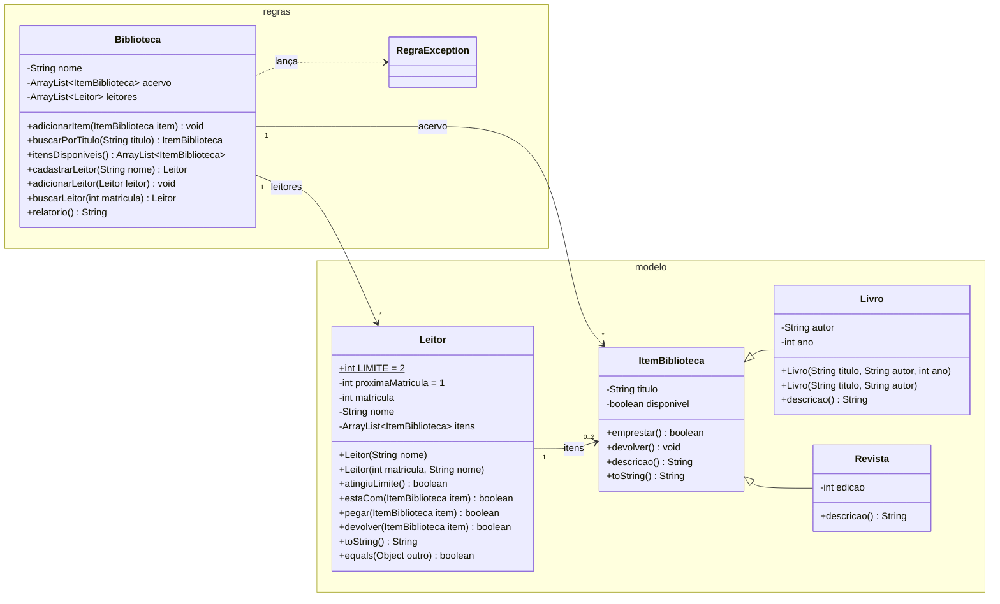

# Prática: matrícula, toString e equals (biblioteca, parte 3)

POO I • 3º INF • 10/11/2026 • aulas 2 a 4 • Apostila: cap. 6, 7 e 10

Continuação de 03/11. A biblioteca agora **cadastra leitores com matrícula**, sabe **se mostrar** (`toString`), sabe **quando dois objetos são o mesmo leitor** (`equals`) e **recusa** o que quebra as regras (`RegraException`).

As classes já estão separadas em **pacotes**, iguais às do sistema final da biblioteca ([`sistema_biblioteca`](../../sistema_biblioteca)):

| Pacote | Classes | O que você faz |
|---|---|---|
| `modelo` | `ItemBiblioteca`, `Livro`, `Revista`, `Leitor` | TODO 1 a 8 |
| `regras` | `Biblioteca`, `RegraException` | TODO 9 a 12 |
| (padrão) | `Aplicacao` | nada: é o teste, não altere |

> **Desta vez não precisa copiar nada da prática anterior.** `ItemBiblioteca`, `Revista` e o `pegar`/`devolver` do `Leitor` já vêm corrigidos.

## Como abrir

1. Copie esta pasta para o computador do laboratório.
2. No NetBeans: **File > Open Project** e selecione a pasta `2026-11-10_Aula03_Matricula` (ícone de xícara).
3. Em Source Packages aparecem três pacotes: `<default package>`, `modelo` e `regras`.
4. **Rode antes de mexer:** botão direito em `Aplicacao.java` > **Run File** (Shift+F6). Repare no que sai no lugar dos textos (`modelo.Livro@d716361`, `Mesma leitora? false`...). É isso que vamos consertar.
5. Complete os `TODO` **na ordem dos números** e rode de novo a cada dois ou três. Confira com os comentários `// Esperado:` do `main`.

## O que mudou desde 03/11

| Antes (03/11) | Agora (10/11) | Por quê |
|---|---|---|
| Tudo no pacote padrão | `modelo` e `regras` | É assim no sistema final: cada camada no seu pacote |
| `new Livro(titulo, autor)` | também `new Livro(titulo, autor, ano)` | **Sobrecarga**: dois construtores, um chama o outro com `this(...)` |
| `Leitor` só tinha nome | tem **matrícula** automática | Um contador `static` da classe dá o número |
| `emprestados`, `quantidadeEmprestados()` | `itens`, `quantidadeItens()` | Mesmos nomes do sistema final |
| `relatorio()` montava `[disponível]...` | `toString()` do item faz isso | O objeto sabe se mostrar; `println(item)` chama sozinho |
| `listarEmprestados()` | `toString()` do leitor: `1 - Ana (0/2)` | Idem |
| `adicionar(item)` aceitava repetido | `adicionarItem(item)` recusa título repetido | Regra vira `RegraException` |

## Diagrama de classes



Sublinhado na UML (`$`) é `static`: pertence à classe. `LIMITE` é igual para todos; `proximaMatricula` é **um contador só**, que todos os leitores compartilham.

## Regras que o código precisa cumprir

**ItemBiblioteca** (TODO 1)
- `toString()`: `[disponível] ` ou `[emprestado] ` seguido de `descricao()`. Como `Livro` e `Revista` têm a sua própria `descricao()`, cada um aparece do seu jeito sem você mudar nada neles.

**Livro** (TODO 2 a 4)
- O construtor de 3 parâmetros é o **único que valida**: autor nulo ou em branco e ano negativo geram `IllegalArgumentException` (`"Autor obrigatório"`, `"Ano inválido"`). Guarde `autor.trim()`.
- O construtor de 2 parâmetros só repassa: `this(titulo, autor, 0)`. Ano `0` quer dizer "não informado".
- `descricao()` só mostra o ano se ele não for 0: `Livro: Dom Casmurro | Autor: Machado de Assis (1899)`.

**Leitor** (TODO 5 a 8)
- `Leitor(nome)` é para leitor **novo**: chama `this(proximaMatricula, nome)`.
- `Leitor(matricula, nome)` é para leitor que **já existia** (por exemplo, lido de um arquivo). Nome nulo/em branco e matrícula ≤ 0 geram `IllegalArgumentException`. Se a matrícula for maior ou igual ao contador, o contador passa para `matricula + 1`: assim a próxima matrícula automática nunca repete.
- `toString()`: `1 - Ana (0/2)`, ou seja, matrícula, nome e itens/limite.
- `equals(outro)`: dois leitores são o mesmo leitor quando têm a **mesma matrícula**, mesmo sendo objetos diferentes (o nome pode ter mudado).

**Biblioteca** (TODO 9 a 12)
- `adicionarItem` recusa título repetido (sem diferenciar maiúsculas) com `RegraException`: `Já existe um item com o título "<título>"`.
- `itensDisponiveis()` devolve uma lista nova só com os disponíveis.
- `adicionarLeitor` recusa matrícula repetida com `RegraException`: `Matrícula repetida: <n>`. Use `leitores.contains(leitor)`: ele pergunta ao `equals` do `Leitor`.
- `buscarLeitor(matricula)` devolve o leitor ou `null`.

## `==` ou `equals`?

```java
Leitor ana = new Leitor("Ana");          // matrícula 1
Leitor outra = new Leitor(1, "Ana");     // outro objeto, mesma matrícula
ana == outra        // false: são dois objetos na memória
ana.equals(outra)   // true (depois do TODO 8): representam o mesmo leitor
```

`==` pergunta "é o **mesmo objeto**?". `equals` pergunta "**representa a mesma coisa**?". Quem decide o que é "a mesma coisa" é você, ao escrever o `equals`. Sem ele, o Java usa o de `Object`, que faz o mesmo que `==`.

## Desafio extra (para quem terminar)

1. Em `Biblioteca`, crie `buscarPorTrecho(String trecho)`, que devolve um `ArrayList<ItemBiblioteca>` com todos os itens cujo título **contém** o trecho, sem diferenciar maiúsculas (`toLowerCase()` e `contains`). `buscarPorTrecho("cas")` acha *Dom Casmurro* e *Vidas Secas*. No `main`, imprima o resultado com um `for`.
2. Comente o seu `equals` do `Leitor` (selecione e `Ctrl+Shift+C`) e rode de novo. Quais linhas da saída mudaram? Por que `adicionarLeitor(anaDoArquivo)` passou a ser aceito?
3. Tire o `static` de `proximaMatricula` e rode. Qual a matrícula do Bruno? Por quê? (Depois, volte o `static`.)

## Plano B, sem o NetBeans

No terminal, dentro desta pasta:

```powershell
New-Item -ItemType Directory -Force -Path build\classes | Out-Null
javac -encoding UTF-8 -d build\classes -sourcepath src src\Aplicacao.java
java -cp build\classes Aplicacao
```

O molde compila e roda antes dos `TODO`; a saída só fica certa depois que você implementar.
