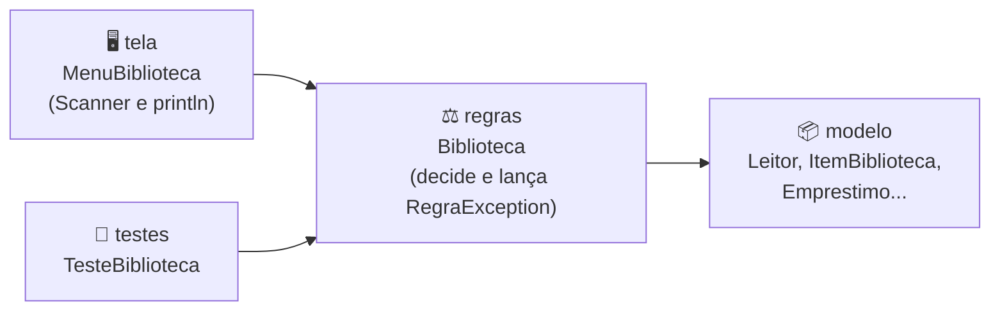
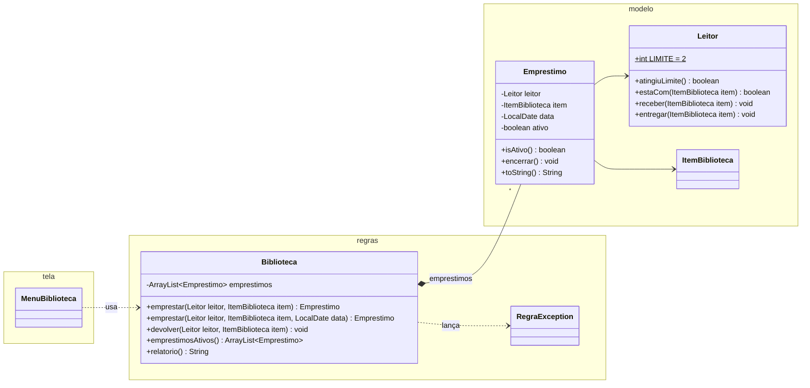

# Prática: empréstimos, menu e testes (biblioteca, parte 4)

POO I • 3º INF • 17/11/2026 • aulas 2 a 4 • Apostila: cap. 9, 12 e 13

Continuação de 10/11. Até agora, era o **leitor** que decidia se podia pegar um item (`pegar`). Isso muda: quem conhece as regras é a **Biblioteca**. Ela empresta, devolve, recusa o que quebra as regras e guarda cada **empréstimo** como um objeto. E o programa ganha mais duas camadas: uma **tela** (menu no terminal) e os **testes**.

| Pacote | Classes | O que você faz |
|---|---|---|
| `modelo` | `ItemBiblioteca`, `Livro`, `Revista` (prontas), `Leitor`, **`Emprestimo`** (nova) | TODO 1 a 4 |
| `regras` | `Biblioteca`, `RegraException` | TODO 5 a 10 |
| `tela` | **`MenuBiblioteca`** (nova): por enquanto, um **menu no terminal** | TODO 11 |
| `testes` | `Verificador` (pronto), **`TesteBiblioteca`** (novo) | TODO 12 e 13 |
| (padrão) | `Aplicacao` | nada: é o teste, não altere |

> **Não precisa copiar nada da prática anterior.** O que vocês fizeram em 10/11 já vem corrigido.

## Como abrir

1. Copie esta pasta para o computador do laboratório.
2. No NetBeans: **File > Open Project** e selecione a pasta `2026-11-17_Aula04_Emprestimos` (ícone de xícara).
3. Em Source Packages aparecem cinco pacotes: `<default package>`, `modelo`, `regras`, `tela` e `testes`.
4. **Rode antes de mexer:** botão direito em `Aplicacao.java` > **Run File** (Shift+F6). Repare: `null` no lugar do empréstimo e três `ERRO:` (as regras ainda não existem).
5. Complete os `TODO` **na ordem dos números**. Confira com os comentários `// Esperado:` do `main`.

## O que mudou desde 10/11

| Antes (10/11) | Agora (17/11) | Por quê |
|---|---|---|
| `leitor.pegar(item)` decidia tudo | `biblioteca.emprestar(leitor, item)` | Regra é da camada de **regras**, não do modelo |
| `pegar` devolvia `false` | regra quebrada lança `RegraException` | A tela mostra **o motivo** da recusa |
| Ninguém lembrava do empréstimo | cada empréstimo vira um objeto `Emprestimo` | Dá para listar os **em aberto** e o histórico |
| `Leitor.pegar`/`devolver` | `Leitor.receber`/`entregar` | O leitor só guarda a lista; quem decide é a Biblioteca |
| Só o `main` de teste | `tela/MenuBiblioteca` e `testes/TesteBiblioteca` | Programa em **camadas** (cap. 12) e **testado** (cap. 13) |

## As camadas



- A **tela** só conversa com o usuário e com a `Biblioteca`. Não tem regra nenhuma. Por enquanto, ela é um **menu no terminal** (janela Output do NetBeans); a janela de verdade vem nos cap. 15 e 16.
- As **regras** não leem teclado e não escrevem na tela: quando algo está errado, lançam `RegraException` e quem chamou decide o que mostrar.
- Os **testes** usam as regras **sem tela**: por isso dá para testar tudo automaticamente.

Mais para a frente, quando a tela virar uma janela (cap. 15 e 16), a `Biblioteca` não vai mudar nada.

## Diagrama de classes



O losango cheio (`*--`) é **composição**: só a `Biblioteca` cria `Emprestimo`, e eles vivem dentro dela.

## Regras que o código precisa cumprir

**Emprestimo** (TODO 1 e 2)
- `encerrar()`: o empréstimo deixa de estar ativo.
- `toString()`: `2026-11-17 | Ana | Dom Casmurro | em aberto` (ou `devolvido`).

**Leitor** (TODO 3 e 4)
- `receber(item)` guarda o item na lista; `entregar(item)` tira. Sem regra nenhuma: quem confere é a Biblioteca.

**Biblioteca** (TODO 5 a 10)
- `emprestar` recusa, nesta ordem, com `RegraException`:
  - leitor no limite: `Ana já está com 2 itens`;
  - item já emprestado (`item.emprestar()` devolve `false`): `"Dom Casmurro" já está emprestado`.
- Se passou: `leitor.receber(item)`, cria o `Emprestimo`, guarda na lista e devolve.
- `devolver` recusa quem não está com o item: `Bruno não está com "Revista do Campus"`. Se passou: `leitor.entregar(item)`, `item.devolver()` e encerra o empréstimo **ativo** daquele item.
- `emprestimosAtivos()` devolve uma lista nova só com os ativos.

**MenuBiblioteca** (TODO 11)
- Opção 2 empresta, opção 3 devolve, sempre dentro de um `try`. No `catch (RegraException e)`, mostre `Erro: ` + a mensagem. Leitor ou título que não existe chega como `null`, e a Biblioteca já recusa com `Escolha um leitor e um item`.
- Para testar: Run File (Shift+F6) em `MenuBiblioteca.java` e digite as opções na janela **Output**.

**TesteBiblioteca** (TODO 12 e 13)
- Escreva os dois testes que faltam, no mesmo formato dos outros. Rode com Run File: a última linha deve ser `10 passaram, 0 falharam.`

## Por que testar?

Testar pelo menu é lento: abrir, digitar, conferir... e repetir tudo a cada mudança. O `TesteBiblioteca` confere as regras **sozinho, em menos de um segundo**. Mudou alguma coisa na `Biblioteca`? Rode os testes: se algum `[FALHA]` aparecer, você sabe exatamente o que quebrou.

## Desafio extra (para quem terminar)

1. No menu, digite uma letra na matrícula. O que acontece? Trate o `NumberFormatException` para o menu mostrar `Matrícula inválida` e continuar.
2. Crie em `Biblioteca` o método `historico(Leitor leitor)`, que devolve todos os empréstimos (ativos ou não) daquele leitor. Acrescente a opção 5 no menu e um teste no `TesteBiblioteca`.
3. Troque a ordem dos TODO 5 e 6 (primeiro o `item.emprestar()`, depois o limite) e rode os testes. Qual teste falha? Por que a ordem importa?

## Plano B, sem o NetBeans

No terminal, dentro desta pasta:

```powershell
New-Item -ItemType Directory -Force -Path build\classes | Out-Null
javac -encoding UTF-8 -d build\classes -sourcepath src src\Aplicacao.java src\tela\MenuBiblioteca.java src\testes\TesteBiblioteca.java
java -cp build\classes Aplicacao
java -cp build\classes testes.TesteBiblioteca
java -cp build\classes tela.MenuBiblioteca
```

O molde compila e roda antes dos `TODO`; a saída só fica certa depois que você implementar.
